# Manual de Usuario — EcoAula
**Plataforma de cursos complementarios cortos y accesibles para personas con discapacidad visual**  
*Universidad del Quindío · Facultad de Ingeniería · Programa de Ingeniería de Sistemas y Computación · Ingeniería de Software III*

---

### Hoja de Control y Metadatos

| Campo | Detalle |
|---|---|
| **Proyecto:** | EcoAula — Aprendizaje Accesible |
| **Entregable:** | Manual de Usuario (Procesos 1 y 2) |
| **Autores:** | Natalia Ramírez Liévano (`nramirezl@uqvirtual.edu.co`)<br>Karen Vanessa Restrepo Morales (`karen.restrepom@uqvirtual.edu.co`)<br>Leonardo Gallego Ríos (`lgallegor@uqvirtual.edu.co`) |
| **Alcance:** | **Proceso 1:** Gestión de inscripción y matrícula accesible (Rol Aprendiz)<br>**Proceso 2:** Gestión de contenido accesible y revisión técnica (Rol Gestor y Revisor) |
| **Despliegue Oficial:** | AWS Lightsail (HTTPS con Let's Encrypt)<br>URL: [https://3-237-185-159.sslip.io](https://3-237-185-159.sslip.io) |
| **Fecha:** | Octubre de 2026 — Armenia, Quindío |

---

## Introducción y Objetivos del Manual

EcoAula es una solución de software diseñada bajo los principios de diseño universal y accesibilidad web estricta (**WCAG 2.1 nivel AA y NTC 5854**), con el propósito de garantizar que personas con discapacidad visual (ciegas o con baja visión) puedan inscribirse, aprender y culminar cursos complementarios cortos de forma completamente autónoma, sin depender de intermediarios, llamadas telefónicas o formatos inaccesibles.

Este manual describe el funcionamiento de los dos procesos transaccionales centrales de la plataforma correspondientes al alcance de esta entrega:
1. **Proceso 1: Gestión de Inscripción y Matrícula Accesible (Rol Aprendiz):** Creación de cuentas accesibles, configuración persistente de preferencias de visualización y voz, consulta del catálogo con cupos en tiempo real y matrícula inmediata.
2. **Proceso 2: Gestión y Publicación de Contenido Accesible (Rol Gestor de Contenido y Revisor):** Producción de contenidos bajo ciclo editorial inmutable (ADR-08), exigencia legal de licencias (Ley 23 de 1982), obligatoriedad de texto alternativo en imágenes (WCAG 1.1.1) y auditoría técnica mediante lista de chequeo formal.

> **Compromiso de Accesibilidad:**  
> Toda la plataforma cuenta con navegación por teclado completa (`Tab`, `Enter`, `Espacio`, `Flechas`), salto directo al contenido principal (WCAG 2.4.1), compatibilidad probada con lectores de pantalla (NVDA, JAWS y VoiceOver), y soporte para reflow y aumento visual al 200% sin pérdida de información (WCAG 1.4.10).

---

## Antes de Empezar: Accesibilidad y Tecnologías de Asistencia

> **Principio Fundamental:**  
> **No es necesario usar el ratón:** todas las funcionalidades de EcoAula operan al 100% mediante navegación por teclado y tecnologías de asistencia.

| Categoría | Tecnologías Soportadas y Recomendadas |
|---|---|
| **Lectores de pantalla** | NVDA (Windows), JAWS (Windows), VoiceOver (macOS / iOS), TalkBack (Android). |
| **Ampliación y Braille** | Ampliadores de pantalla de sistema operativo, ZoomText y terminales de línea braille efímera. |
| **Navegadores certificados** | Google Chrome, Microsoft Edge, Mozilla Firefox o Safari (versiones actualizadas con conexión a internet). |

### Matriz de Actores: ¿Quién usa EcoAula?

| Rol / Actor | Qué hace en la plataforma | Vista inicial al acceder |
|---|---|---|
| **Visitante (sin cuenta)** | Consulta información pública, se registra, inicia sesión o reporta barreras. | `/login` o `/reportar-barrera` |
| **Aprendiz** | Configura su perfil sensorial, se matricula en cursos, estudia con audio/transcripción, presenta evaluaciones y obtiene certificados. | `/cursos` (Catálogo) |
| **Gestor de contenido** | Diseña cursos, administra lecciones, carga audio nativo e imágenes con `alt`, declara derechos de autor y envía borradores a revisión. | `/gestor/cursos` |
| **Revisor de accesibilidad** | Audita técnicamente versiones con checklist WCAG 2.1 AA / NTC 5854, aprueba para publicación o emite rechazos con subsanación. | `/revisor/cola` |
| **Coordinación de matrícula** | Resuelve y responde reportes de barreras de accesibilidad y hace seguimiento a los indicadores de calidad y riesgo de abandono. | `/reportes-barrera` |
| **Entidad verificadora** | Comprueba la autenticidad e integridad de certificados estudiantiles mediante código alfanumérico sin necesidad de tener cuenta. | `/verificar` |

---

## Índice de Contenido

- [Parte I: Portal del Aprendiz (Proceso 1 — Inscripción y Matrícula)](#parte-i-portal-del-aprendiz-proceso-1--inscripción-y-matrícula)
  - [1). Acceso al Portal y Página de Inicio de Sesión](#1-acceso-al-portal-y-página-de-inicio-de-sesión)
  - [2). Registro de Nueva Cuenta y Consentimiento de Datos Sensibles (Ley 1581)](#2-registro-de-nueva-cuenta-y-consentimiento-de-datos-sensibles-ley-1581)
  - [3). Configuración y Prueba del Perfil de Accesibilidad](#3-configuración-y-prueba-del-perfil-de-accesibilidad)
  - [4). Exploración del Catálogo de Cursos y Verificación de Cupos](#4-exploración-del-catálogo-de-cursos-y-verificación-de-cupos)
  - [5). Aula Virtual y Reproducción Accesible de Lecciones](#5-aula-virtual-y-reproducción-accesible-de-lecciones)
- [Parte II: Portal del Gestor de Contenidos (Proceso 2 — Producción Editorial)](#parte-ii-portal-del-gestor-de-contenidos-proceso-2--producción-editorial)
  - [1). Acceso y Panel Principal de Cursos Registrados](#1-acceso-y-panel-principal-de-cursos-registrados)
  - [2). Creación de Cursos y Asignación de Cupos Máximos](#2-creación-de-cursos-y-asignación-de-cupos-máximos)
  - [3). Estructura y Administración de Lecciones](#3-estructura-y-administración-de-lecciones)
  - [4). Ciclo Editorial Inmutable: Historial de Versiones (ADR-08)](#4-ciclo-editorial-inmutable-historial-de-versiones-adr-08)
  - [5). Edición de Borradores: Transcripción, Audio e Imágenes con Texto Alternativo](#5-edición-de-borradores-transcripción-audio-e-imágenes-con-texto-alternativo)
  - [6). Declaración de Derechos de Autor (Ley 23 de 1982) y Envío a Revisión](#6-declaración-de-derechos-de-autor-ley-23-de-1982-y-envío-a-revisión)
- [Parte III: Portal del Revisor de Accesibilidad (Proceso 2 — Auditoría Técnica)](#parte-iii-portal-del-revisor-de-accesibilidad-proceso-2--auditoría-técnica)
  - [1). Bandeja de Cola de Revisión Técnica](#1-bandeja-de-cola-de-revisión-técnica)
  - [2). Auditoría con Checklist Oficial WCAG 2.1 AA y NTC 5854](#2-auditoría-con-checklist-oficial-wcag-21-aa-y-ntc-5854)
  - [3). Emisión y Consulta de Informes de Revisión Técnica Imprimibles](#3-emisión-y-consulta-de-informes-de-revisión-técnica-imprimibles)
- [Parte IV: Soporte, Reporte de Barreras y Glosario Técnico](#parte-iv-soporte-reporte-de-barreras-y-glosario-técnico)
  - [1). Canal Público de Reporte de Barreras](#1-canal-público-de-reporte-de-barreras)
  - [2). Glosario de Accesibilidad Web y Arquitectura](#2-glosario-de-accesibilidad-web-y-arquitectura)
- [Anexo: Protocolo Rápido de Navegación por Teclado](#anexo-protocolo-rápido-de-navegación-accesible-por-teclado)

---

## Parte I: Portal del Aprendiz (Proceso 1 — Inscripción y Matrícula)

### 1). Acceso al Portal y Página de Inicio de Sesión

* **Acción del Usuario:** El aprendiz ingresa a `https://3-237-185-159.sslip.io/login`. Digita su correo y contraseña institucional y presiona *Entrar a mi cuenta*. Si no posee cuenta, pulsa *Crear una cuenta nueva*. Si detecta alguna barrera, puede pulsar el enlace público para reportarla sin iniciar sesión.
* **Respuesta del Sistema:** Valida las credenciales contra MySQL (BCrypt). Al autenticar con éxito, recupera las preferencias persistentes del perfil y redirige al catálogo.
* ♿ **Criterio de Accesibilidad:** WCAG 2.4.1 (Salto directo al contenido principal con `Tab`), etiquetas `<label>` vinculadas por `id` y regiones `role="alert"` para anunciar fallos de autenticación.

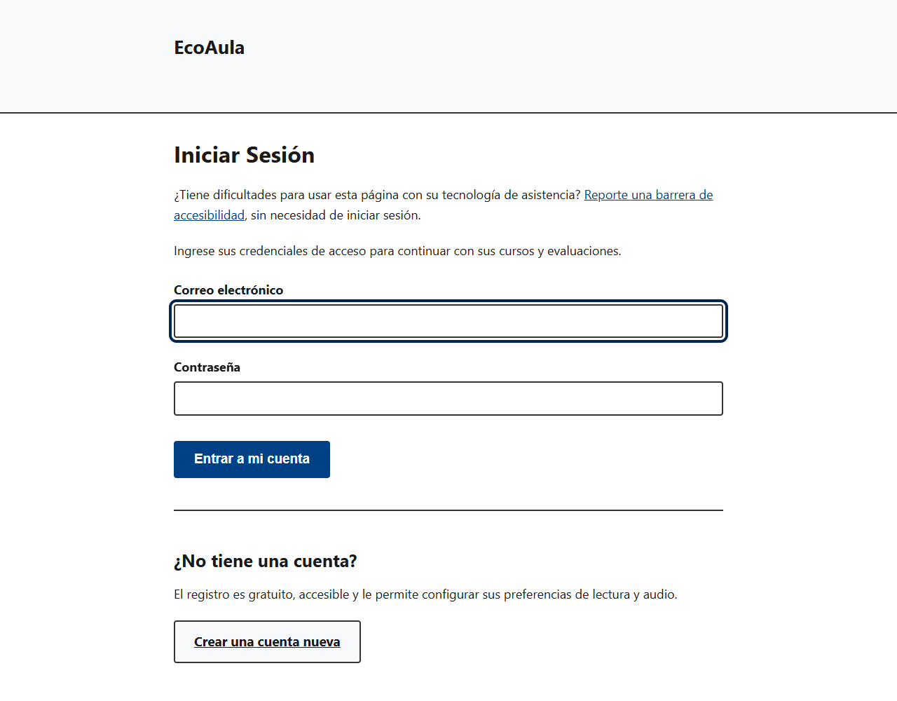

---

### 2). Registro de Nueva Cuenta y Consentimiento de Datos Sensibles (Ley 1581)

* **Acción del Usuario:** El usuario completa sus datos básicos y selecciona voluntariamente su condición visual (ceguera o baja visión). Debe marcar obligatoriamente la casilla de consentimiento informado antes de enviar.
* **Respuesta del Sistema:** El backend cifra en reposo el dato sensible de la condición visual usando AES-256 en modo GCM (ADR-09), garantizando conformidad con la Ley 1581 de 2012 y el Decreto 1377 de 2013.
* ♿ **Criterio de Accesibilidad:** Formulario semántico accesible por teclado y foco visible permanente (#002752 / #00FFFF).

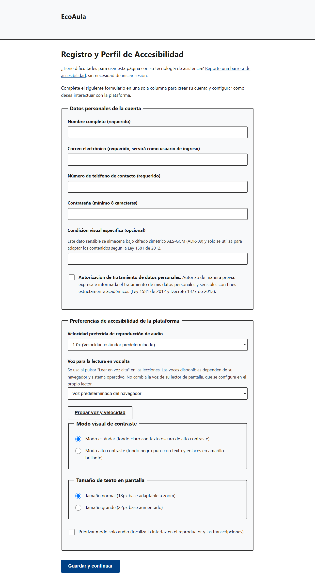

---

### 3). Configuración y Prueba del Perfil de Accesibilidad

* **Acción del Usuario:** El estudiante accede a `/perfil` y personaliza: modo visual (Alto Contraste o Estándar), tamaño de texto, velocidad de audio (1.0x a 2.0x) y voz del sintetizador en español. Al pulsar *Probar voz y velocidad*, escucha una muestra de audio.
* **Respuesta del Sistema:** Las preferencias se guardan de forma persistente en base de datos (ADR-07) y se aplican en la sesión actual en todas las vistas de la plataforma.
* ♿ **Criterio de Accesibilidad:** ADR-07 (Perfil persistente) y Web Speech API integrada en el navegador.

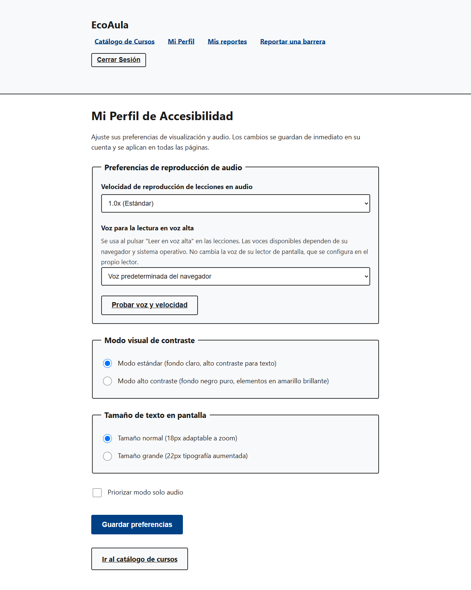

---

### 4). Exploración del Catálogo de Cursos y Verificación de Cupos

* **Acción del Usuario:** El aprendiz navega por el catálogo de cursos (`/cursos`). Consulta el título, horas de duración, evaluación asociada y cupos disponibles en tiempo real (ej. *Cupos disponibles: 15 de 20*). Pulsa el botón *Matricularme*.
* **Respuesta del Sistema:** El servicio ejecuta una consulta con bloqueo pesimista en base de datos (`PESSIMISTIC_WRITE`) para evitar sobrecupos ante matrículas concurrentes. Si el cupo se agota, el botón se bloquea con un mensaje accesible.
* ♿ **Criterio de Accesibilidad:** Tarjetas de curso semánticas con encabezados `<h2>` para navegación por encabezados (`H`) en lectores de pantalla.

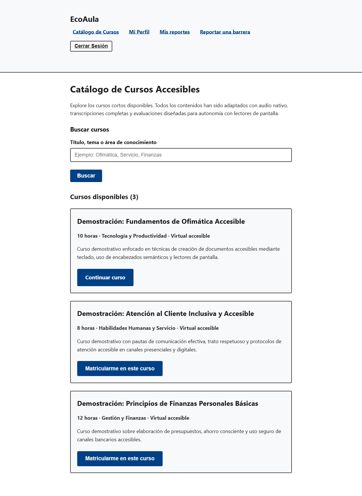

---

### 5). Aula Virtual y Reproducción Accesible de Lecciones

* **Acción del Usuario:** Al abrir una lección (`/cursos/{id}/lecciones/{orden}`), el estudiante puede reproducir el audio con la barra nativa, leer la transcripción completa, o presionar *Leer en voz alta la transcripción* para escucharla con la voz y velocidad de su perfil.
* **Respuesta del Sistema:** El archivo de audio se entrega con soporte para cabeceras HTTP Range (`206 Partial Content`), permitiendo adelantar y pausar sin esperar la descarga completa. Al presionar *Completar y continuar*, el avance del estudiante se actualiza.
* ♿ **Criterio de Accesibilidad:** ADR-05 (Reproductor `<audio>` nativo con atajos `Espacio` y `Flechas`) y WCAG 1.2.1 / 1.2.2 (Transcripción textual completa).

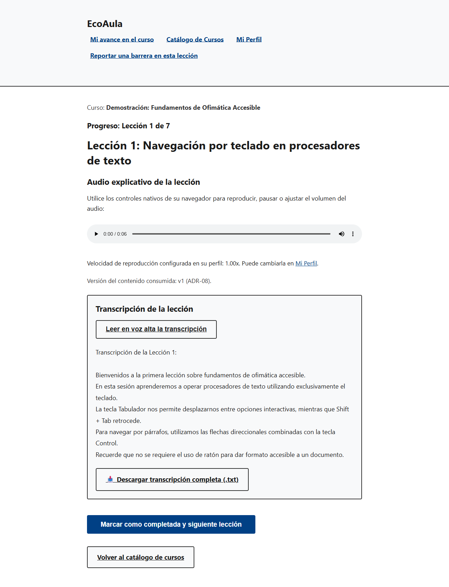

---

## Parte II: Portal del Gestor de Contenidos (Proceso 2 — Producción Editorial)

> **Principio del Ciclo de Vida Editorial:**  
> Cada lección sigue un flujo estricto e inmutable de estados:
> * **Borrador:** Edición de audio, transcripción, imágenes con `alt` y declaración legal de derechos de autor.
> * **En Revisión:** Encolada para dictamen técnico; no modificable por el gestor mientras está en auditoría.
> * **Publicada (Versión Vigente):** Aprobada con el 100% de criterios WCAG/NTC 5854. Se congela de por vida y los aprendices la consumen.
> * **Rechazada:** Contiene no conformidades documentadas en un informe formal; habilita la opción de *Subsanación* para generar un nuevo borrador corregido.
> 
> *Regla de oro:* Cada lección tiene una sola versión vigente y una sola en trámite a la vez. Lo publicado nunca se sobrescribe (ADR-08).

### 1). Acceso y Panel Principal de Cursos Registrados

* **Acción del Usuario:** El gestor inicia sesión institucional y el sistema lo enruta a `/gestor/cursos`. Puede visualizar todos los cursos registrados, su estado de catálogo (*EN EL CATÁLOGO* o *FUERA DEL CATÁLOGO*), horas y aprendices inscritos.
* **Respuesta del Sistema:** Se bloquea la eliminación o modificación estructural de cursos que ya cuenten con estudiantes matriculados para no alterar su avance académico.
* ♿ **Criterio de Accesibilidad:** Control de acceso estricto mediante Spring Security (`hasRole('GESTOR_CONTENIDO')`).

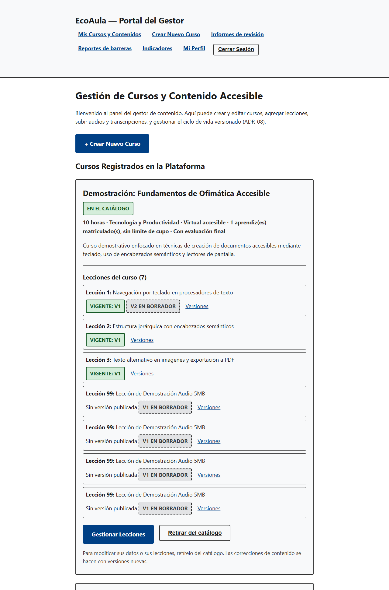

---

### 2). Creación de Cursos y Asignación de Cupos Máximos

* **Acción del Usuario:** El gestor pulsa *+ Crear Nuevo Curso* y diligencia el título, descripción, duración (validada entre 8 y 40 horas según el caso de estudio) y el cupo máximo de aprendices.
* **Respuesta del Sistema:** El curso nace *FUERA DEL CATÁLOGO* y permanece oculto para los estudiantes hasta que todas sus lecciones hayan sido aprobadas por el revisor de accesibilidad.
* ♿ **Criterio de Accesibilidad:** Validación de negocio con mensajes de error accesibles anunciados por `aria-live`.

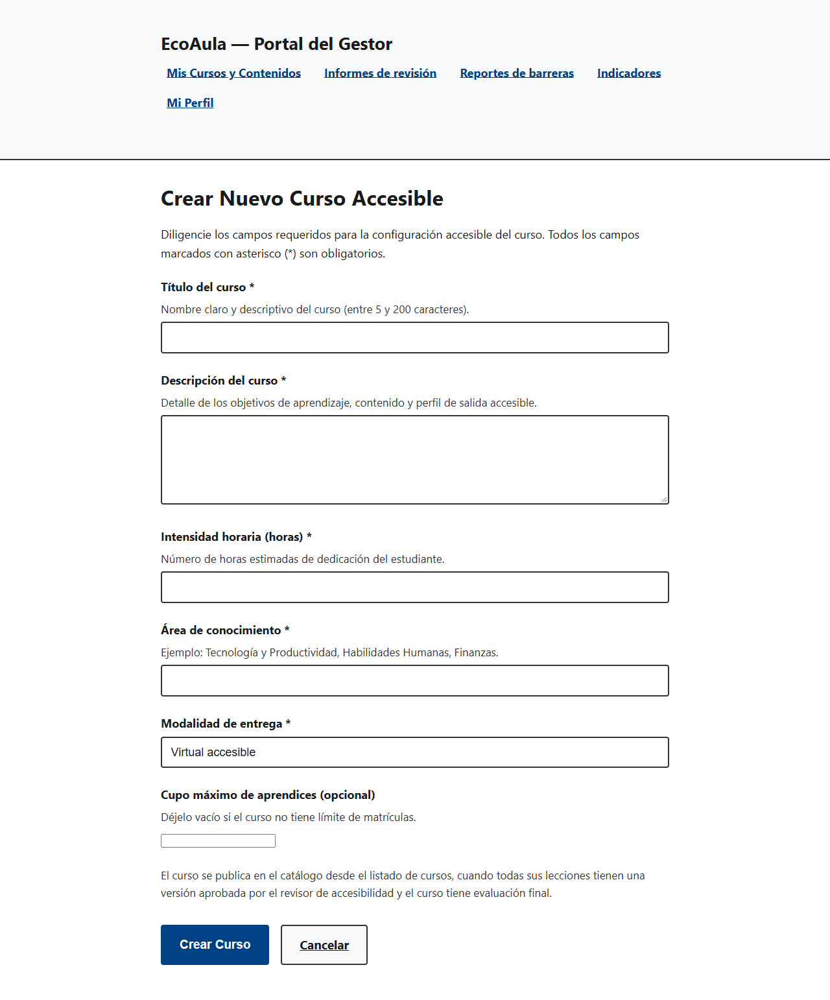

---

### 3). Estructura y Administración de Lecciones

* **Acción del Usuario:** Al pulsar *Gestionar lecciones*, el gestor añade lecciones con título descriptivo.
* **Respuesta del Sistema:** El sistema asigna automáticamente el número de orden secuencial sin huecos (1, 2, 3...) para garantizar que la navegación del estudiante sea continua. La lección se crea con su Versión 1 en estado `BORRADOR`.
* ♿ **Criterio de Accesibilidad:** Ordenamiento secuencial estricto para evitar pérdidas en la navegación por lecciones.

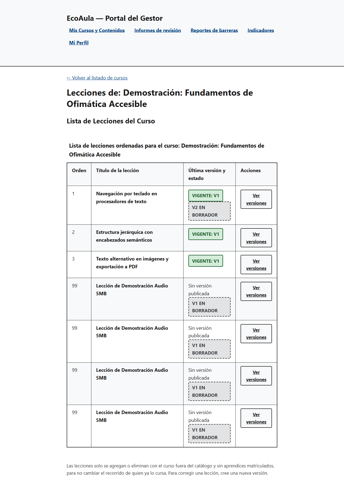

---

### 4). Ciclo Editorial Inmutable: Historial de Versiones (ADR-08)

* **Acción del Usuario:** Al pulsar *Ver versiones*, el gestor accede al historial inmutable. Las versiones `PUBLICADAS` y `RETIRADAS` son de solo lectura. Para actualizar una lección, pulsa *+ Crear Nueva Versión en Borrador*.
* **Respuesta del Sistema:** Se genera la versión 2 en estado `BORRADOR`, heredando automáticamente la transcripción, el audio y las imágenes de la versión vigente.
* ♿ **Criterio de Accesibilidad:** ADR-08 (Inmutabilidad editorial): trazabilidad histórica sin sentencias `UPDATE` en contenidos aprobados.

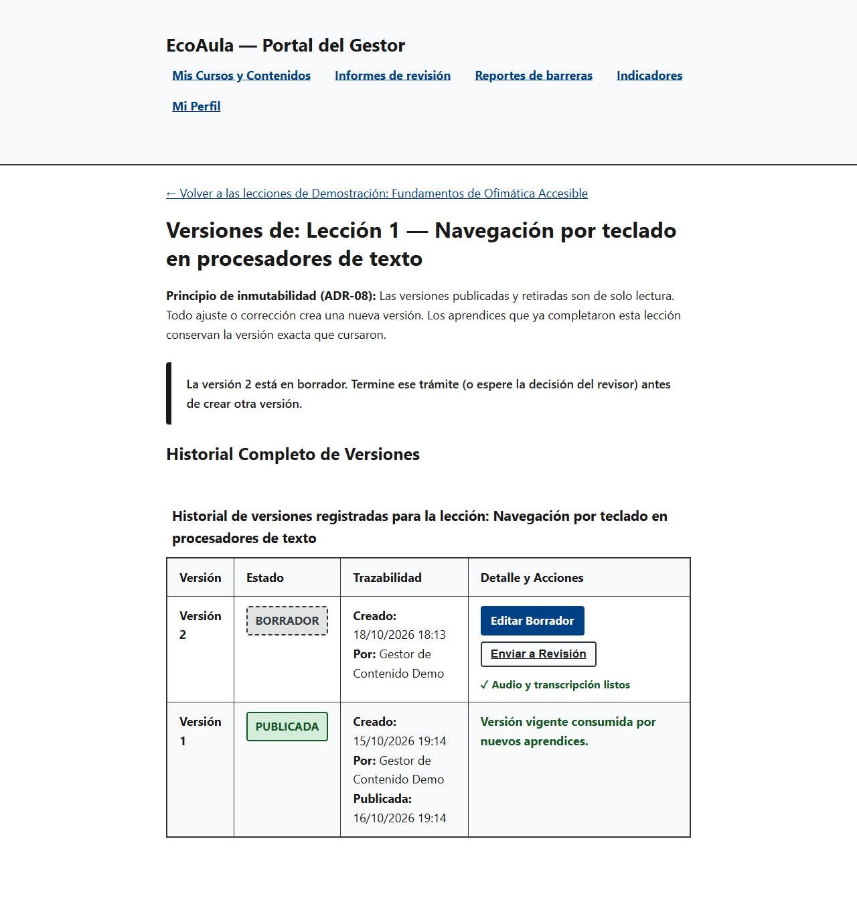

---

### 5). Edición de Borradores: Transcripción, Audio e Imágenes con Texto Alternativo

* **Acción del Usuario:** En el editor (`/gestor/versiones/{id}/editar`), el gestor sube el archivo de audio (MP3, WAV u OGG de hasta 15 MB), escribe la transcripción completa y carga imágenes de apoyo con su *Texto alternativo (alt)* obligatorio.
* **Respuesta del Sistema:** El servidor rechaza cualquier imagen sin texto alternativo antes de persistirla en disco y base de datos.
* ♿ **Criterio de Accesibilidad:** WCAG 1.1.1 (Contenido no textual): texto alternativo obligatorio validado a nivel de backend.

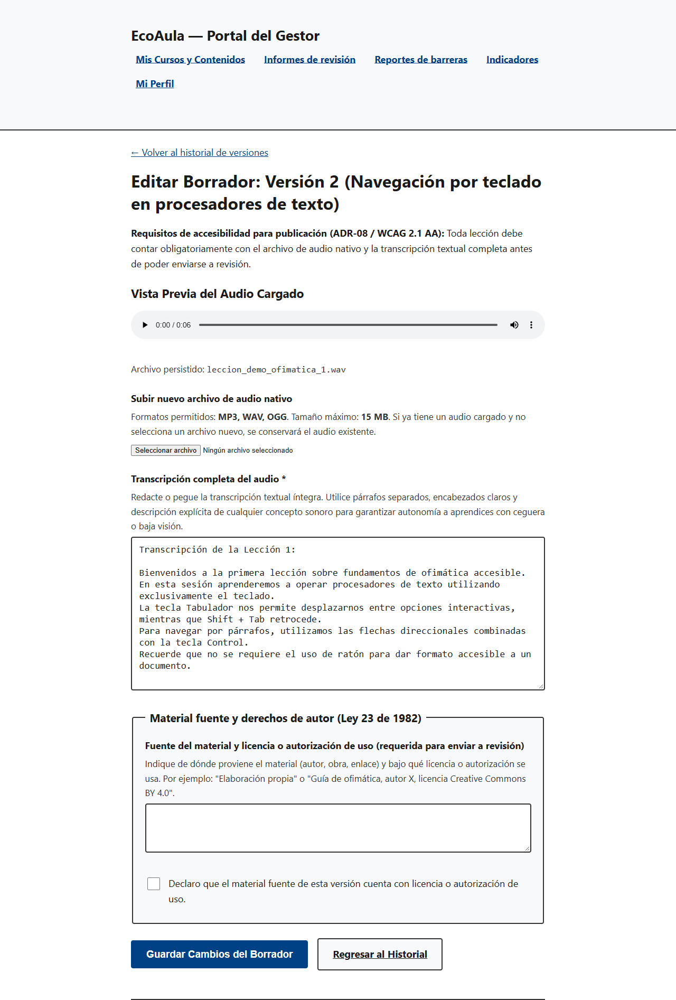

---

### 6). Declaración de Derechos de Autor (Ley 23 de 1982) y Envío a Revisión

* **Acción del Usuario:** En la sección inferior del editor, el gestor registra la Fuente del material y marca la casilla de autorización legal bajo la Ley 23 de 1982. Luego pulsa *✓ Guardar y enviar esta versión a Revisión Técnica*.
* **Respuesta del Sistema:** Valida que existan audio, transcripción y licencia. La versión pasa a estado `EN_REVISION` y se añade a la cola del Revisor de Accesibilidad.
* ♿ **Criterio de Accesibilidad:** Cumplimiento de la Ley 23 de 1982 sobre Derechos de Autor y trazabilidad de licencias de uso educativo.

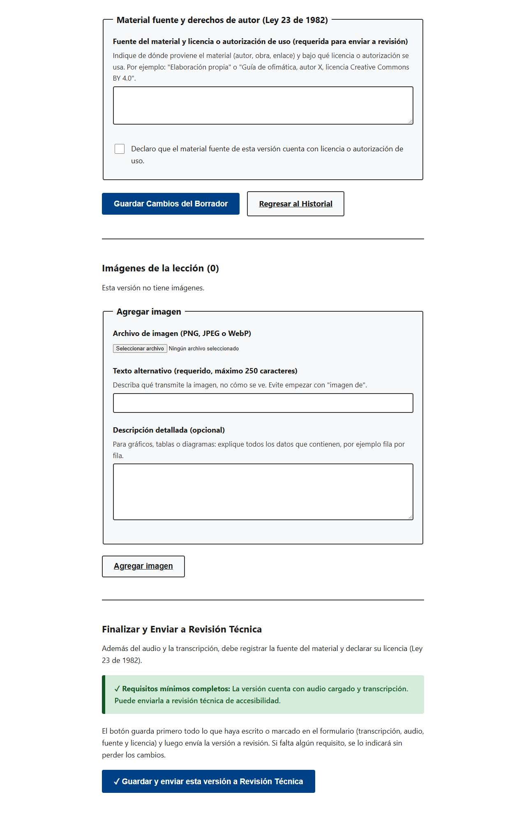

---

## Parte III: Portal del Revisor de Accesibilidad (Proceso 2 — Auditoría Técnica)

### 1). Bandeja de Cola de Revisión Técnica

* **Acción del Usuario:** El revisor técnico inicia sesión y accede a `/revisor/cola`. Observa la lista de versiones pendientes con autor, fecha de envío e indicación de si es una versión inicial o una subsanación de rechazo previo.
* **Respuesta del Sistema:** Aplica separación estricta de funciones: un gestor no puede auditar ni aprobar sus propios contenidos.
* ♿ **Criterio de Accesibilidad:** Separación de roles institucionales y bandeja ordenada cronológicamente.

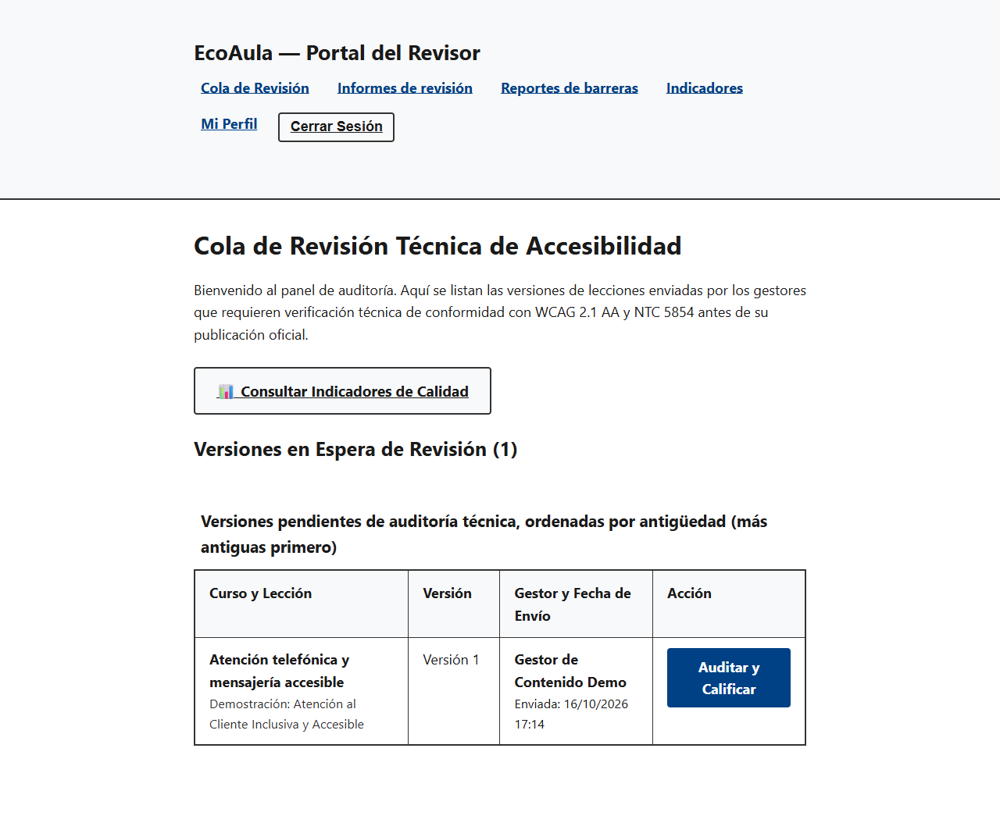

---

### 2). Auditoría con Checklist Oficial WCAG 2.1 AA y NTC 5854

* **Acción del Usuario:** Al presionar *Auditar y Calificar*, el revisor escucha el audio, analiza la transcripción e inspecciona las imágenes. En el formulario marca los 6 criterios de accesibilidad técnica (claridad de audio, transcripción fiel, estructura jerárquica, idioma español, sin referencias visuales y enlaces comprensibles).
* **Respuesta del Sistema:** Exige el 100% de los criterios marcados para autorizar la publicación oficial (*Aprobar y Publicar*). La versión pasa a `PUBLICADA` y la anterior a `RETIRADA`. Si no cumple, el revisor registra el motivo de no conformidad y pulsa *Rechazar Versión*.
* ♿ **Criterio de Accesibilidad:** NTC 5854 y WCAG 2.1 AA: umbral del 100% de cumplimiento para emitir aprobación oficial.

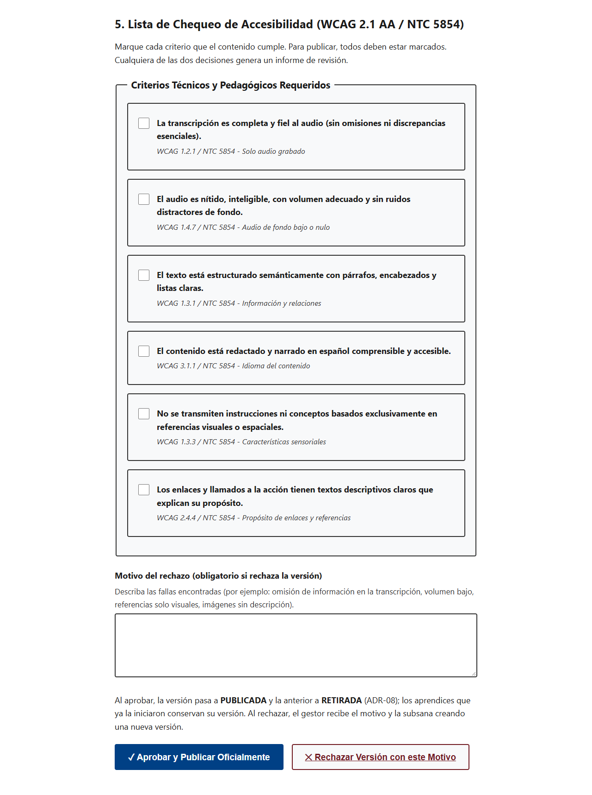

---

### 3). Emisión y Consulta de Informes de Revisión Técnica Imprimibles

* **Acción del Usuario:** Tanto el gestor como el revisor pueden ingresar a `/informes-revision` para consultar las auditorías realizadas con su resultado (*APROBADA* o *RECHAZADA*).
* **Respuesta del Sistema:** Cada informe detalla la fecha, el revisor y el checklist de criterios cumplidos y no cumplidos. La vista incluye diseño optimizado para impresión formal (`Ctrl + P`), sirviendo como evidencia auditable para el Plan de Calidad.
* ♿ **Criterio de Accesibilidad:** Trazabilidad documental inmutable e imprimible para aseguramiento de calidad institucional.

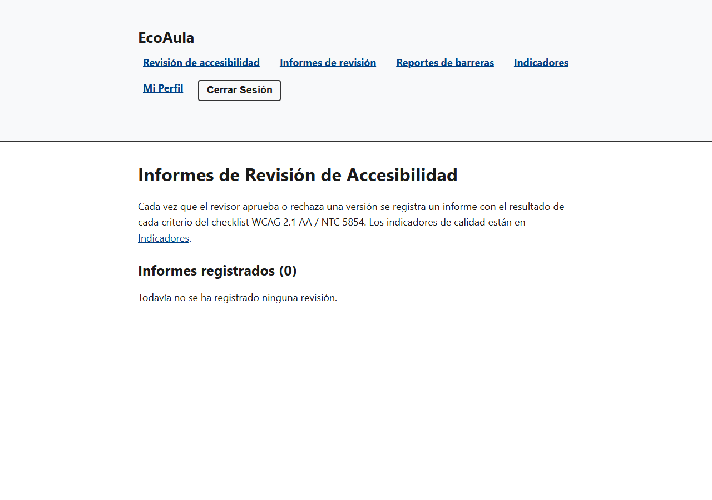

---

## Parte IV: Soporte, Reporte de Barreras y Glosario Técnico

### 1). Canal Público de Reporte de Barreras

En cumplimiento de la **Ley Estatutaria 1618 de 2013** y la **Resolución 1519 de 2020 del MinTIC**, EcoAula dispone de un mecanismo permanente y público para reportar barreras de accesibilidad sin necesidad de iniciar sesión previa.

* **URL del Canal:** [https://3-237-185-159.sslip.io/reportar-barrera](https://3-237-185-159.sslip.io/reportar-barrera)
* **Funcionalidad:** Cualquier aspirante, estudiante o tutor que identifique incompatibilidad con su tecnología de asistencia (NVDA, JAWS, VoiceOver), problemas de contraste visual, ausencia de textos descriptivos o dificultades en el teclado, puede registrar la incidencia para su subsanación prioritaria por parte del equipo de calidad.

### 2). Glosario de Accesibilidad Web y Arquitectura

| Concepto / Norma | Definición Técnica y Operativa en EcoAula |
|---|---|
| **WCAG 2.1 (Nivel AA)** | Pautas internacionales de accesibilidad web del W3C adoptadas por Colombia. Exigen que la interfaz sea Perceptible, Operable, Comprensible y Robusta. |
| **NTC 5854** | Norma Técnica Colombiana que define los requisitos de accesibilidad digital para plataformas y portales web en el país. |
| **Texto Alternativo (`alt`)** | Descripción textual sintética (máx. 250 caracteres) obligatoria en cada imagen para que los lectores de pantalla transmitan su contenido a personas con ceguera (WCAG 1.1.1). |
| **Bloqueo Pesimista (ADR-06)** | Mecanismo de concurrencia en base de datos (`SELECT ... FOR UPDATE`) implementado en el servicio de matrícula para garantizar cero sobrecupos ante matrículas simultáneas. |
| **Inmutabilidad Editorial (ADR-08)** | Principio de arquitectura por el cual una versión de contenido publicada nunca se sobreescribe con `UPDATE`. Toda corrección da origen a una nueva versión en borrador. |
| **Cifrado en Reposo (ADR-09)** | Cifrado criptográfico simétrico AES-256 en modo GCM para proteger la condición visual del estudiante en base de datos, en cumplimiento de la Ley 1581 de 2012. |
| **Lector de Pantalla** | Software de asistencia (NVDA, JAWS, TalkBack, VoiceOver) que transforma el árbol semántico del navegador en síntesis de voz o salida braille. |

### 3). Verificación Pública de Autenticidad de Certificados

Cualquier empresa, entidad verificadora o ciudadano puede corroborar la validez de un certificado emitido por EcoAula sin necesidad de contar con una cuenta en la plataforma:

* **En la interfaz web:** Acceder a [https://3-237-185-159.sslip.io/verificar](https://3-237-185-159.sslip.io/verificar) (o pulsar el hipervínculo impreso en el certificado), digitar el código alfanumérico (formato `EA-XXXX-XXXX-XXXX-XXXX`) y pulsar *Validar autenticidad*.
* **Desde sistemas externos (API REST):** `GET /api/v1/certificados/{codigo}/verificacion` retorna un objeto JSON estandarizado:
  ```json
  {"valido": true}
  ```
* ♿ **Protección de Datos y Seguridad:** La consulta es pública y está protegida contra abusos mediante limitación de tasa (*Rate Limiting* por IP). En estricto apego al principio de minimización de datos (Ley 1581 de 2012), el servicio únicamente confirma la autenticidad sin exponer el nombre ni la condición visual del estudiante.

---

## Parte V: Solución de Problemas Frecuentes (FAQ / Troubleshooting)

A continuación se resumen las dudas y situaciones operativas más comunes observadas durante el uso de la plataforma y su resolución inmediata:

| Situación Observada | Causa Probable | Solución / Qué Hacer |
|---|---|---|
| **No aparece el botón "Matricularme" en un curso** | El curso agotó sus cupos disponibles o el aprendiz ya se encuentra matriculado en él. | Si ya está inscrito, pulsar *"Continuar curso"*. Si no hay cupos (*0 de N disponibles*), aguardar a que la coordinación amplíe la capacidad del grupo. |
| **No aparece o no funciona "Leer en voz alta"** | El navegador no cuenta con paquetes de voces en español o no soporta Web Speech API. | Utilizar Google Chrome o Microsoft Edge e instalar voces en español en la configuración de accesibilidad del sistema operativo. |
| **No se visualiza el avance del curso tras cerrar sesión** | El estudiante no pulsó el botón de finalización de la lección antes de salir. | El progreso se consolida al pulsar *"Completar y continuar"*. La sección *"Mi curso"* en el catálogo muestra siempre la última lección completada. |
| **(Gestor) El sistema no permite "Guardar y enviar a revisión"** | Falta adjuntar el archivo de audio, escribir la transcripción, ingresar la fuente o marcar la casilla legal. | Verificar que los 4 requisitos obligatorios del borrador estén diligenciados antes de enviar a revisión. |
| **(Gestor) No aparece el botón "Crear Nueva Versión en Borrador"** | La lección ya cuenta con una versión en estado `BORRADOR` o `EN_REVISION` en trámite. | Por regla de integridad editorial, debe esperarse el dictamen del revisor o editar el borrador existente. |
| **(Revisor) El sistema no permite "Aprobar y Publicar" una versión** | No se han marcado la totalidad de los 6 criterios del checklist de accesibilidad. | Marcar el 100% de los criterios normativos si la versión cumple, o registrar el motivo de no conformidad y presionar *"Rechazar Versión con este Motivo"*. |

---

## Anexo: Protocolo Rápido de Navegación Accesible por Teclado

Para verificar la plataforma sin utilizar el mouse:

| Tecla / Atajo | Función en EcoAula | Criterio WCAG |
|---|---|---|
| `Tab` | Desplazar el foco al siguiente control interactivo (enlace, botón, campo). | 2.1.1 (Teclado) |
| `Shift + Tab` | Retroceder el foco al control interactivo anterior. | 2.1.1 (Teclado) |
| `Enter` | Activar enlaces, botones y enviar formularios. | 2.1.1 (Teclado) |
| `Espacio` | Alternar casillas de verificación (checkboxes) y pausar/reanudar el audio nativo. | ADR-05 |
| `Flechas (↑ ↓ ← →)` | Seleccionar opciones de radio button y adelantar/retrasar segundos en el reproductor. | ADR-05 |
| `H` (NVDA / JAWS) | Saltar secuencialmente entre encabezados de la página (`<h1>`, `<h2>`, `<h3>`). | 2.4.6 (Encabezados) |
| `Tab` al cargar página | Revela el enlace visible: *"Saltar al contenido principal"*. | 2.4.1 (Evitar bloques) |

---

## Anexo: Cuentas del Ambiente de Demostración

Para facilitar la evaluación y verificación funcional de los procesos de la plataforma, el sistema cuenta con cuentas preconfiguradas para cada uno de los roles:

| Rol | Correo Institucional | Contraseña (Desarrollo / Local) | Vista Inicial al Iniciar Sesión |
|---|---|---|---|
| **Aprendiz** | `aprendiz@ecoaula.local` | `EcoAula2026!` | `/cursos` (Catálogo de cursos) |
| **Gestor de contenido** | `gestor@ecoaula.local` | `GestorEcoAula2026!` | `/gestor/cursos` (Panel editorial) |
| **Revisor de accesibilidad** | `revisor@ecoaula.local` | `RevisorEcoAula2026!` | `/revisor/cola` (Bandeja de auditoría) |
| **Coordinación de matrícula** | `coordinador@ecoaula.local` | `CoordinadorEcoAula2026!` | `/reportes-barrera` (Gestión de incidencias) |

> 📌 **Nota de Seguridad de Entornos:**
> * Las contraseñas indicadas en la tabla corresponden al ambiente de desarrollo y pruebas locales (perfiles `dev` y `dev-h2`).
> * En el servidor de producción cloud (AWS Lightsail con perfil `prod`), por directriz de hardening institucional (`DataInitializer.java`), las contraseñas se gestionan de forma segura e independiente mediante variables de entorno en `/etc/ecoaula/ecoaula.env`.

