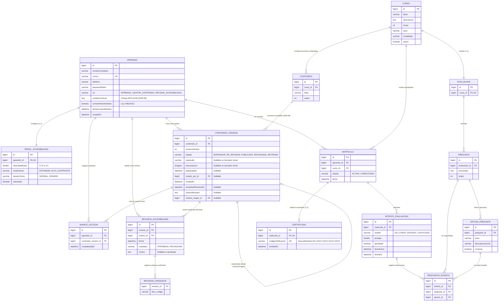

# Modelo de Datos y Entidad-Relación — EcoAula

Este documento detalla el modelo de datos relacional implementado en EcoAula conforme al ADR-04 (MySQL relacional con llaves foráneas y restricciones explícitas) y ADR-08 (Versionamiento inmutable y ciclo de vida editorial de contenidos accesibles).

---

## 1. Diagrama Entidad-Relación (Mermaid)

---

## 2. Reglas de Integridad y Restricciones Centrales

1. **Restricción Única de Matrícula (`uk_matricula_aprendiz_curso`):**
   - Un aprendiz no puede matricularse más de una vez en el mismo curso (`UNIQUE (aprendiz_id, curso_id)`).
2. **Inmutabilidad y Trazabilidad de Contenido (ADR-08):**
   - `AvanceLeccion` almacena la llave foránea exacta a `ContenidoVersion`. Esto garantiza que si una lección se actualiza tras ser cursada, queda registrado qué versión exacta consumió el estudiante.
   - Solo puede existir **una versión `PUBLICADA`** a la vez por lección (`Contenido`). Al publicar una nueva versión aprobada, la anterior pasa automáticamente al estado `RETIRADA` sin eliminarse jamás de la base de datos ni del disco.
   - Las versiones en estado `PUBLICADA` y `RETIRADA` son estrictamente de solo lectura.
   - Una versión `RECHAZADA` conserva de manera inmutable el motivo de no conformidad; para corregirla, el gestor genera un nuevo `BORRADOR` que referencia a la versión rechazada a través de `version_origen_id`.
3. **Separación Estricta de Funciones en Auditoría:**
   - Un usuario no puede auditar una versión que él mismo creó como gestor (`creado_por_id != revisor_id`).
   - Los revisores no pueden editar contenidos ni borradores (`REVISOR_ACCESIBILIDAD` restringido en la capa de servicio).
   - Los gestores no pueden aprobar publicaciones (`GESTOR_CONTENIDO` restringido en la capa de servicio).
4. **Cifrado de Datos Sensibles (ADR-09):**
   - El campo `condicionVisual` en `APRENDIZ` se cifra de forma transparente mediante `CondicionVisualConverter` con el algoritmo AES-GCM (128 bits de autenticación).
5. **Verificación Pública Sin Exposición (ADR-06):**
   - El código en `CERTIFICADO` es un identificador aleatorio de alta entropía. La API pública valida únicamente su existencia y vigencia, sin revelar la identidad del estudiante.

---

## 3. Alcance del Proceso 2 (Contenido Accesible)

- **Implementado en esta entrega:**
  - Ciclo editorial completo: `BORRADOR → EN_REVISION → (PUBLICADA | RECHAZADA)`.
  - Requisito de accesibilidad no negociable: Toda lección debe poseer archivo de audio nativo (`.mp3`, `.wav`, `.ogg`) y transcripción textual completa antes de poder enviarse a revisión.
  - Almacenamiento desacoplado en disco local con nombres saneados únicos (`UUID`) y límite configurable de 15 MB.
  - Lista de chequeo técnica de 6 criterios WCAG 2.1 AA / NTC 5854.
  - Auditoría de trazabilidad (`RevisionAccesibilidad`) e indicadores de calidad (tasa de accesibilidad en primera revisión y tiempo promedio de publicación).
- **Fuera de alcance (exclusiones de la entrega):**
  - No se soportan imágenes con texto alternativo (los cursos se basan exclusivamente en audio nativo y transcripciones textuales accesibles).
  - No se soportan videos con audiodescripción sincronizada ni lenguaje de señas.
