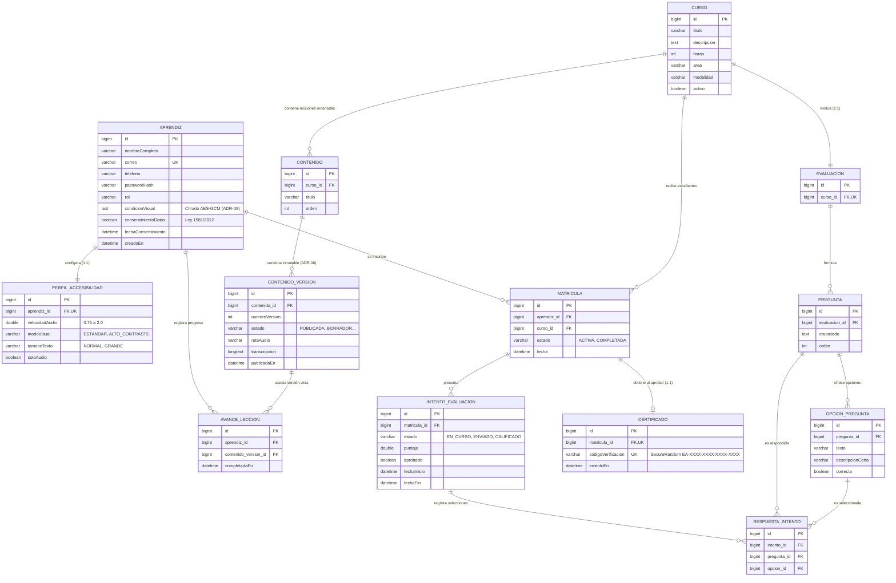

# Modelo de Datos y Entidad-Relación — EcoAula

Este documento detalla el modelo de datos relacional implementado en EcoAula conforme al ADR-04 (MySQL relacional con llaves foráneas y restricciones explícitas).

---

## 1. Diagrama Entidad-Relación (Mermaid)

---

## 2. Reglas de Integridad y Restricciones Centrales

1. **Restricción Única de Matrícula (`uk_matricula_aprendiz_curso`):**
   - Un aprendiz no puede matricularse más de una vez en el mismo curso (`UNIQUE (aprendiz_id, curso_id)`).
2. **Inmutabilidad y Trazabilidad de Contenido (ADR-08):**
   - `AvanceLeccion` almacena la llave foránea exacta a `ContenidoVersion`. Esto garantiza que si una lección se actualiza después de que el estudiante la cursó, queda registrado qué versión exacta consumió.
3. **Cifrado de Datos Sensibles (ADR-09):**
   - El campo `condicionVisual` en `APRENDIZ` se cifra de forma transparente mediante `CondicionVisualConverter` con el algoritmo AES-GCM (128 bits de autenticación).
4. **Verificación Pública Sin Exposición (ADR-06):**
   - El código en `CERTIFICADO` es un identificador aleatorio de alta entropía. La API pública valida únicamente su existencia y vigencia, sin revelar la identidad del estudiante.
